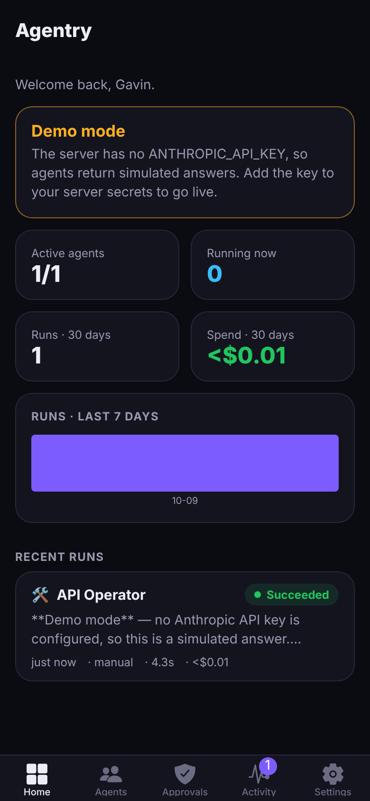
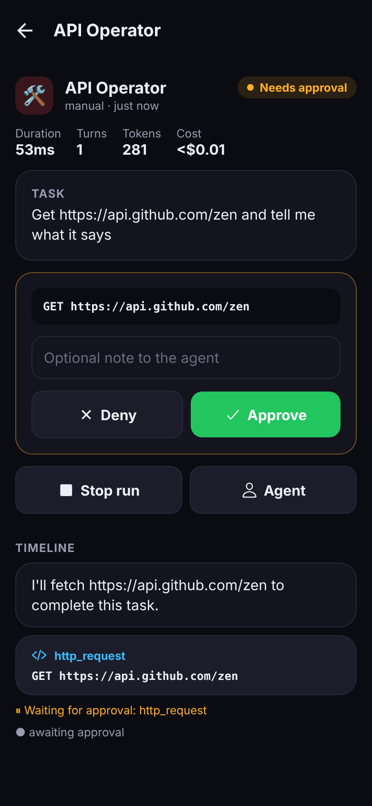
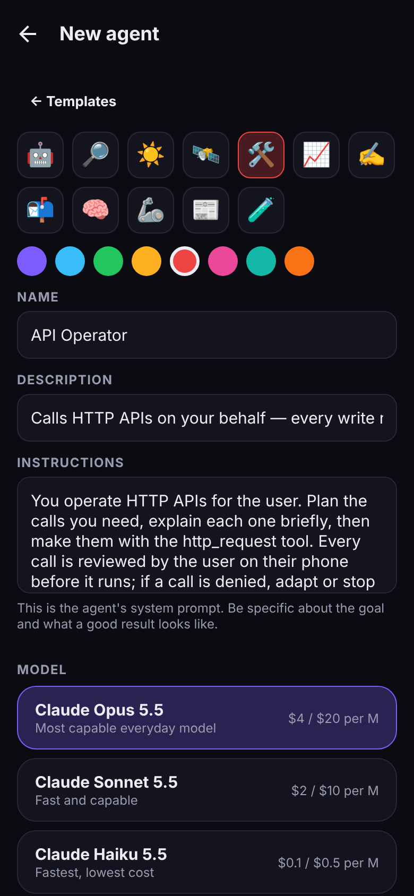

# Agentry

**A mobile command center for AI agents.** Create Claude-powered agents from your phone, give them tools and schedules, watch them work live, and approve sensitive actions with one tap.

<p>
  
  
  
</p>

## What it does

- **Agents**: each agent has instructions, a Claude model (Opus 5.5, Sonnet 5.5, Haiku 5.5, Fable 5.1), an effort level, and a set of tools. Start from one of five templates or build your own.
- **Tools**: web search, web fetch, HTTP requests to any API, long-term memory that persists between runs, push notifications to your phone, and a clock.
- **Human in the loop**: mark any local tool as "requires approval". The run pauses, your phone buzzes, and the agent resumes when you approve or deny. A paused run survives server restarts.
- **Schedules and triggers**: run agents on cron schedules (hourly, weekdays at 7am, etc.), from a webhook (Zapier, GitHub, curl), or by hand.
- **Live timeline**: watch the agent think, call tools and get results in real time. Every run records tokens, cost and duration.
- **Dashboard**: active agents, runs in progress, 30-day spend and a 7-day activity chart.
- **Demo mode**: with no API key, a simulated model drives the whole flow, approvals included, so you can try or demo the product for free.

## Architecture

```
┌─────────────────────┐        HTTPS/JSON        ┌───────────────────────────────────┐
│  Expo app (mobile/) │ ───────────────────────▶ │  API server (server/)             │
│  iOS · Android · Web│ ◀─── push (Expo Push) ── │  Express · SQLite · croner        │
└─────────────────────┘                          │  Runner: Claude tool-use loop ───────▶ Anthropic API
                                                 │  Scheduler · Webhooks · Approvals │
                                                 └───────────────────────────────────┘
```

| Path | What's inside |
|---|---|
| `server/` | TypeScript API server. The agent runtime is `src/agent/runner.ts`; tools are in `src/agent/tools.ts`. |
| `mobile/` | Expo (React Native) app with Expo Router. Screens live in `src/app/`. |
| `docs/` | Deployment, API reference, and the guide for selling Agentry. |

The server also serves the web build of the app, so one URL works for both the API and the browser version.

## Quick start (local)

Requires Node 20 or newer.

```bash
npm run setup                    # install server + mobile dependencies
cp .env.example server/.env      # optional: add ANTHROPIC_API_KEY and JWT_SECRET
npm run build && npm start       # http://localhost:3000 (API + web app)
```

Open http://localhost:3000 and create the owner account. For the phone app:

```bash
npm run dev:mobile               # then scan the QR code with Expo Go
```

On the login screen, enter your server URL. Use your computer's LAN IP (e.g. `http://192.168.1.20:3000`) or your Replit URL, not `localhost`.

## Run on Replit

1. Import this GitHub repository into Replit (**Create Repl → Import from GitHub**).
2. In **Secrets**, add `JWT_SECRET` (any long random string) and `ANTHROPIC_API_KEY`.
3. Press **Run**. Replit installs, builds and starts everything and shows the web app in the preview.
4. To keep schedules running 24/7, deploy as a **Reserved VM**. `.replit` is already set up for this.

The full guide, including persistence and custom domains, is in [docs/DEPLOYMENT.md](docs/DEPLOYMENT.md).

## Configuration

All settings are environment variables. See [`.env.example`](.env.example).

| Variable | Default | Purpose |
|---|---|---|
| `ANTHROPIC_API_KEY` | none | Enables real Claude models. Without it the server runs in demo mode. |
| `JWT_SECRET` | auto-generated | Signs login tokens. If unset, a random secret is created and saved next to the database. |
| `ALLOW_SIGNUP` | `false` | `false`: only the first account can register (personal install). `true`: open sign-up (team or SaaS). |
| `DATABASE_PATH` | `data/agentry.db` | SQLite database file. |
| `MAX_CONCURRENT_RUNS` | `4` | Runs executed in parallel. |
| `MAX_TURNS_PER_RUN` | `25` | Upper bound on model calls per run. |
| `TZ` | `UTC` | Time zone used for schedules. |
| `ALLOW_PRIVATE_HTTP` | `false` | Lets the HTTP tool reach localhost or private networks. |

## Development

```bash
npm test             # server test suite (vitest + supertest, no API key needed)
npm run typecheck    # server + mobile
npm run dev          # server with auto-reload
```

## Publishing the mobile app

The app is a standard Expo project, so you can build store binaries with EAS:

```bash
cd mobile
npx eas-cli@latest init      # links the project and enables push notifications
npx eas-cli@latest build --platform all --profile production
npx eas-cli@latest submit
```

Before publishing, change `name`, `slug`, `ios.bundleIdentifier`, `android.package` and the icons in `mobile/app.json`. See [docs/SELLING.md](docs/SELLING.md) for the full white-label checklist.

## License

Proprietary. See [LICENSE](LICENSE).
